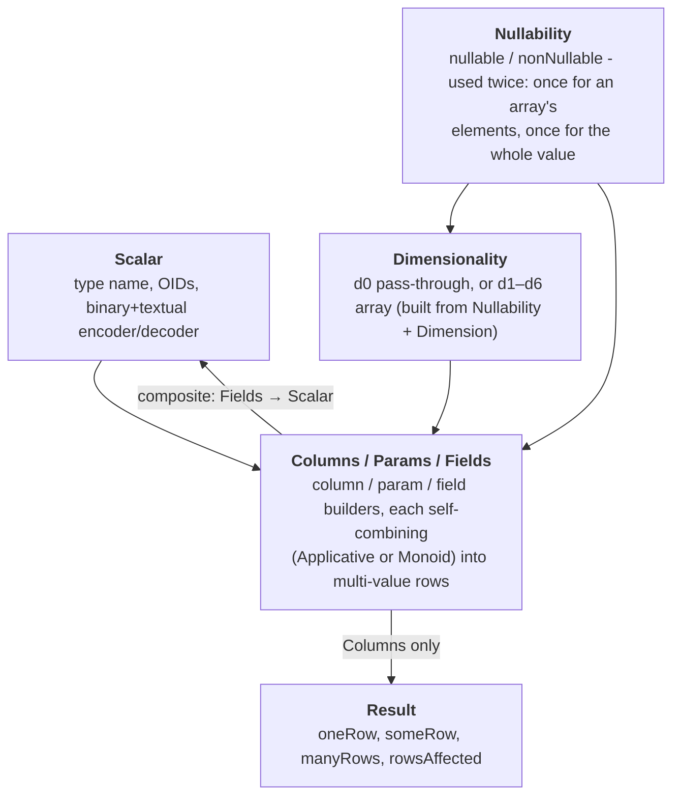

# postgresql-codecs

[](https://hackage.haskell.org/package/postgresql-codecs)
[](https://nikita-volkov.github.io/postgresql-codecs/)

**postgresql-codecs** is a driver-agnostic Haskell library for encoding and
decoding PostgreSQL values. It covers both the binary and textual wire formats
and ships no I/O itself. It is designed to be easy to integrate with any PostgreSQL driver.

## Architecture

`column` / `param` / `field` each combine the same three independent ingredients - `Scalar`,
`Dimensionality`, and `Nullability` - into a `Columns`, `Params`, or `Fields` value.
`Nullability` is used twice: once *inside* `Dimensionality` (is an array element nullable?) and
once again *outside* it (is the whole value nullable?). `Result` wraps `Columns` only, and
`composite` closes a cycle by building a `Scalar` out of `Fields`.



## Quick example

`column`, `param`, and `field` resolve a type's codec from its `IsScalar` instance - they do not
take a `Scalar` value directly. Every standard PostgreSQL type, and several plain Haskell types
(`Int32`, `Int64`, `Text`, `Bool`, `Double`, `Day`, `LocalTime`, `UTCTime`, `UUID`, `ByteString`,
`Scientific`, …), already has one. Write your own for an enum or composite:

```haskell
import Data.Profunctor (lmap)
import qualified PostgresqlCodecs as Pc

-- An enum scalar. The schema and type name must match the server-side `CREATE TYPE`.
-- `enum` requires an `Ord` constraint on the value type.
data Color = Red | Green | Blue
  deriving (Eq, Ord, Show)

instance Pc.IsScalar Color where
  scalar =
    Pc.enum "public" "color"
      [ ("red", Red),
        ("green", Green),
        ("blue", Blue)
      ]

-- A composite scalar. Each field is `field <dimensionality> <nullability>`; select the
-- input record field with `lmap`, since `Fields` is a `Profunctor`.
data Point = Point {x :: Int32, y :: Int32}

instance Pc.IsScalar Point where
  scalar =
    Pc.composite "public" "point" $
      Point
        <$> lmap (.x) (Pc.field Pc.d0 Pc.nonNullable)
        <*> lmap (.y) (Pc.field Pc.d0 Pc.nonNullable)

-- A query-parameter encoder and a result-column decoder both reuse the instance:
pointParam :: Pc.Params Point
pointParam = Pc.param Pc.d0 Pc.nonNullable

pointColumn :: Pc.Columns Point
pointColumn = Pc.column Pc.d0 Pc.nonNullable
```

Dimensionality (`d0` for a scalar, `d1`–`d6` for an N-dimensional array over some
`Dimension` like `vector`) and nullability (`nonNullable` / `nullable`) are chosen at each call
site - there is, deliberately, no `IsScalar` instance for `Maybe` or an array/vector type. To
decode several columns into one row, combine `Columns` values applicatively
(`Functor` / `Applicative`); to encode several parameters, combine `Params` values with their
`Semigroup` / `Monoid` instances (`Contravariant`).

A type that needs more than one PostgreSQL representation should not share one Haskell type across
both - a class instance is a single, global, coherence-checked choice per type, so it can't express
that. Define a distinct newtype per representation, each with its own instance. The
`columnWith` / `paramWith` / `fieldWith` trio takes an explicit `Scalar` instead of an instance,
but it exists only for a type with no static representation to hang an instance on (e.g. a codec
resolved at runtime from schema introspection) - never as a bypass for a type that already has, or
should have, an instance.

## For driver authors

This package serves two audiences through two modules. Application code imports
`PostgresqlCodecs` and never sees driver detail. Driver authors import `PostgresqlCodecs.Core`
instead. It is the codec *anatomy* (the record fields of `Params`, `Columns`, `Result`, `Scalar`,
plus `ConsumesColumns`, `Resolver`, `TypeOids`, and `Format`) and documents the OID-resolution
contract a driver must fulfill.
